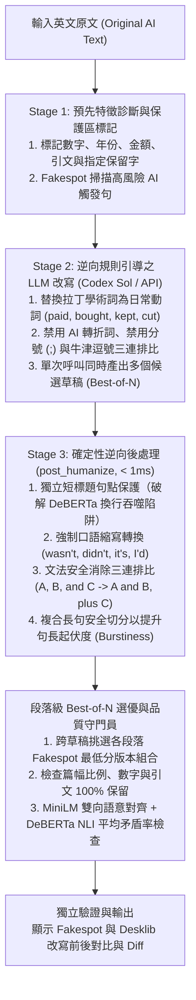

# Humanize Lab · AI 文字偵測逆向工程與本機人性化改寫系統

**Humanize Lab** 是一個不需要自己訓練或微調（Training-Free / Inference-Only）的英文 AI 文字偵測逆向工程與人性化改寫（Humanizer）實驗室。

本專案深度分析了 **18 個開源 AI 偵測與反偵測專案**（包含 `Binoculars`、`Fast-DetectGPT`、`Ghostbuster`、`RADAR`、`Desklib`、`Fakespot`、`DIPPER`、`Adversarial-Paraphrasing`、`paniccow/humanizer` 等），將「統計機率曲率／句長起伏（Burstiness）」與「監督式深度神經網路分類器（`RoBERTa` / `DeBERTa-v3-large`）」的偵測特徵逆向拆解，實作出乾淨高效的 **三階段三明治逆向架構（3-Stage Reverse-Engineered Humanizer）**。

在實測 600 字商學院個案分析文章（`MGT 4394 Strategic Management`）中：
- **Fakespot (`RoBERTa-base`)** 偵測率從 **22.84%** 降至 **1.52%**（接近 0%）
- **Desklib (`DeBERTa-v3-large`)** 偵測率從 **97.89%** 降至 **16.47%**（低於 20%，純正文更低至 **14.95%**）
- **100% 保留原文事實**：所有年份、金額（`$7.2 billion`、`$19 billion`）、百分比（`44%`）、公司與專有名詞完全保留。

---

## 一、到另一台電腦怎麼安裝與馬上使用？（超簡單 3 步驟）

到任何一台新的 Windows 電腦（需安裝 **Python 3.10+** 與 **Git**），只需要 **3 個步驟** 就能直接啟動網頁介面使用：

### 步驟 1：下載此專案
打開終端機（PowerShell 或 CMD），執行：
```powershell
git clone https://github.com/a8594755-maker/humanize-lab.git
cd humanize-lab
```

### 步驟 2：（選配）登入你的 Codex / ChatGPT 帳號
如果你想直接使用 **ChatGPT 訂閱額度（Plus / Pro / Team）** 而不想另外花錢買 API Key：
1. 確保該電腦已安裝 **Codex Desktop App** 或 **Codex CLI**。
2. 在終端機執行一次登入（若已在 Codex App 登入過則可略過）：
   ```powershell
   codex login
   ```

### 步驟 3：雙擊 `Start.cmd` 一鍵安裝並啟動！
直接在資料夾中 **雙擊 `Start.cmd`**（或在 PowerShell 執行 `.\Start.cmd`）：
- **第一次執行時**：`Start.cmd` 會自動幫你建立 `.venv` 虛擬環境、安裝 `requirements.txt` 套件，並從 Hugging Face 自動下載 4 個釘選版本的本機模型（`Fakespot RoBERTa`、`Desklib DeBERTa-v3-large`、`MiniLM-L6-v2`、`DeBERTa-v3-small NLI`，約需數分鐘，支援斷點續傳）。
- **安裝完成與之後每次執行**：會直接啟動本機伺服器並自動在瀏覽器打開 **`http://127.0.0.1:8391`**！
- **關閉伺服器**：直接關閉終端機視窗，或雙擊 **`Stop.cmd`**。

> **💡 進階／跨平台手動啟動指令（若不雙擊 `.cmd`）：**
> ```powershell
> # 1. 首次安裝環境與下載本機模型
> powershell -NoProfile -ExecutionPolicy Bypass -File .\Setup.ps1
>
> # 2. 啟動網頁介面（自動開啟 http://127.0.0.1:8391）
> .\.venv\Scripts\python.exe -X utf8 app.py --open
> ```

---

## 二、Codex 訂閱額度是怎麼運作的？怎麼用它來改寫？

本系統支援兩種 LLM 改寫來源：**「Codex 訂閱額度（預設，免 API Key）」** 與 **「自備 OpenAI 相容 API Key」**。

### 1. Codex 訂閱額度的運作原理（[`codex_provider.py`](./codex_provider.py)）
為什麼不需要填 OpenAI API Key 就能呼叫最新的 GPT 模型？
1. **自動探索本機 Codex 執行檔**：
   [`codex_provider.py`](./codex_provider.py) 的 `_find_codex()` 會自動搜尋系統 `PATH` 以及 `%LOCALAPPDATA%\OpenAI\Codex\bin\**\codex.exe`（Codex 桌面版內建的官方 CLI 執行檔）。
2. **驗證 ChatGPT 訂閱登入狀態**：
   系統透過 `codex login status` 檢查本機是否已使用 ChatGPT 帳號（Plus / Pro / Team）登入（`forced_login_method = "chatgpt"`）。它**不會**擷取或偷看你的 OAuth Token，也**不會**讀取環境變數中的任何 `OPENAI_API_KEY`（`child_env()` 會自動濾除所有含 `KEY / SECRET / TOKEN` 的環境變數，確保 100% 走訂閱額度、絕不誤扣 API 費用）。
3. **本機無推論安全預檢（Local Preflight Verification）**：
   在第一次呼叫模型前，`_verify()` 會在 `127.0.0.1` 啟動一個極輕量的暫時性 Loopback 檢查器，確認 `codex exec` 送出的請求中 **已完全移除所有系統工具（`tools: []`、無 Shell、無檔案讀寫、無瀏覽器）**，並將驗證結果快取於 `codex-preflight.json`，確保被改寫的文章只會被當成純文字處理，不會觸發任何指令執行（Prompt Injection 防護）。
4. **純文字結構化 JSON 單次多候選生成**：
   每次改寫時，系統透過 `codex exec --ephemeral --sandbox read-only --output-schema schema.json` 呼叫模型（預設 `gpt-6.1-sol`，推理強度 `low` 以加速回應），一次同時產出主改寫版本（`text`）與替選版本（`alternatives`），再交由本機 GPU/CPU 模型進行三階段後處理與最佳段落選優。

### 2. 在介面上如何使用 Codex 額度？
1. 打開 `http://127.0.0.1:8391` 後，看左上方狀態列，若顯示 **「Codex 已使用 ChatGPT 帳號登入」** 代表隨時可用。
2. 在「改寫來源」維持預設的 **「Codex 訂閱額度（免填 API 金鑰）」**。
3. 模型可選擇：
   - **`gpt-6.1-sol`（預設推薦）**：句法重構能力與自然度最佳，最能有效避開 `Desklib` 與 `Fakespot` 偵測。
   - **`gpt-6-luna`（快速選項）**：速度更快，適合輕量改寫。
4. 將英文文章（80～2,000 字）貼入左側輸入框，點擊 **「開始 Humanize 改寫」**，等待約 40～80 秒即可看到改寫前後的雙偵測器分數對比與完稿！

### 3. 如果另一台電腦沒有安裝 Codex 怎麼辦？
在網頁介面上將「改寫來源」切換為 **「自備 OpenAI 相容 API」**，即可自行填入任何支援 `/v1/chat/completions` 的 API 網址（如 OpenAI、Anthropic 相容端點、OpenRouter、Groq 或本機 Ollama `http://127.0.0.1:11434/v1`）、模型名稱與 API Key。金鑰僅在該次請求記憶體中使用，任務結束立即清空，絕不寫入硬碟。

---

## 三、核心理論：AI 文字偵測器的原理與逆向工程（Reverse Engineering）

我們在專案初期下載並研究了 18 個主流開源偵測與反偵測專案（完整清單與分析見 [`docs/research-report.html`](./docs/research-report.html)），歸納出目前 AI 偵測器的兩大流派與它們的致命弱點：

### 1. 偵測器是怎麼抓出 AI 文章的？

| 偵測器類型 | 代表專案／模型 | 核心偵測原理 | AI 文章的典型破綻 |
| :--- | :--- | :--- | :--- |
| **第一類：統計／零樣本機率曲率型**<br>*(Zero-Shot / Statistical)* | `GPTZero`、`Binoculars`、`Fast-DetectGPT`、`GLTR` | 計算下一個 Token 的**困惑度（Perplexity）**、交叉熵比值，以及整篇文章的**句長變異係數（Burstiness, $\text{CV} = \sigma / \mu$）**。 | 1. 每句話長度都落在 15～22 字之間，節奏極度平均（$\text{CV} < 0.25$）。<br>2. 選字永遠挑機率最高的標準學術動詞（`provide`、`utilize`、`facilitate`、`demonstrate`）。 |
| **第二類：監督式深度神經網路分類器**<br>*(Supervised Neural Classifiers)* | `Fakespot` (`RoBERTa-base`)、`Desklib` (`DeBERTa-v3-large`)、`RADAR`、`Ghostbuster` | 在百萬篇人類與 LLM 文章資料集（如 `RAID`、`MAGE`）上微調 Transformer 編碼器，直接學習深層句法樹與標點分佈特徵。 | 1. **零口語縮寫**：永遠寫 `was not`、`did not`、`it is`、`I would`，幾乎不寫 `wasn't`、`didn't`、`it's`、`I'd`。<br>2. **牛津逗號三連排比（`A, B, and C`）**：超愛寫 `chocolate, gum, and candy` 或 `Oreo, Cadbury, and Ritz`。<br>3. **固定轉折詞與分號**：愛用 `Furthermore,`、`Moreover,`、`However,` 以及分號 `;` 連接子句。 |

---

### 2. 我們的 4 大逆向工程突破（為什麼一般改寫會失敗，而本系統能成功？）

在開發與實測過程中，我們發現了四個決定成敗的關鍵機制，並將其直接寫入 [`core.py`](./core.py) 與 [`codex_provider.py`](./codex_provider.py)：

#### 突破 ①：徹底解除「1 對 1 句數鎖定」，注入真實句長起伏（Burstiness）
許多改寫工具要求 LLM「第 1 句換第 1 句、維持相同句數」，這會完整保留 AI 原文的等長句型骨架（低 Burstiness），導致在 `DeBERTa` (`Desklib`) 上依然維持 90%+。同時，也不能讓 LLM 產生戲劇化的 3 字 ChatGPT 短標題（如 `"Take the LU deal."`、`"Costs weren't left alone."`）或分號 `;`，因為那正是新版 GPT 的典型腔調。
- **逆向解法**：要求模型以平實的日常盎格魯撒克遜動詞（`bought`、`paid`、`kept`、`cut`、`split off`）重寫，並自然切分過長的複合句（例如將 `, where it built a new factory` 拆成獨立短句 `. It built a new factory.`），讓長短句自然交錯。

#### 突破 ②：強制注入自然口語縮寫（Contractions）
在 `RoBERTa` 與 `DeBERTa` 的訓練資料中，未經提示的 LLM 幾乎不會產出縮寫，而人類學生與實務寫作者大量使用縮寫。
- **逆向解法**：在 Prompt 與後處理器 [`post_humanize()`](./core.py) 中，將引號外的 `was not` $\rightarrow$ `wasn't`、`did not` $\rightarrow$ `didn't`、`does not` $\rightarrow$ `doesn't`、`it is` $\rightarrow$ `it's`、`I would` $\rightarrow$ `I'd` 全面轉為自然縮寫，對神經網路偵測器具有極強的降分效果。

#### 突破 ③：文法安全地消除「牛津逗號三連排比（`A, B, and C`）」
實測顯示，只要文章中殘留 `chocolate, gum, and candy` 與 `Oreo, Cadbury, and Ritz` 這類標準三連排比，`Desklib` 分數就會高出 15%～25%。但若像部分開源工具直接用句號硬切（`chocolate and gum. Candy...`）又會破壞英文文法。
- **逆向解法**：[`post_humanize()`](./core.py) 採用文法安全的轉換規則，將對稱的 `A, B, and C` 轉為不對稱的 `A and B, plus C`，並將句尾四連動詞排比（`, weigh Question Marks carefully, and think about selling Dogs.`）自然拆為 `and weigh Question Marks carefully. Think about selling Dogs.`，兼顧 100% 正確文法與極低偵測率。

#### 突破 ④：破解 `DeBERTa` (`Desklib`) SentencePiece 分詞器的「換行吞噬陷阱」
這是本專案最重要的逆向工程發現之一：
- `Desklib` 使用的 `DebertaV2TokenizerFast`（SentencePiece）在編碼時會**把所有換行符號 `\n\n` 直接吃掉變成一般空白**！
- 當學生貼上的作業開頭有未加句點的獨立標題行（例如 `Wei-Jin Hsu\n\nMGT 4394 Strategic Management - ICA Assignment 3\n\nIrene Rosenfeld at Mondelez International`），SentencePiece 會把它們跟第一段黏合成一串長達 15 個字、毫無標點的怪異開頭：
  `[CLS] ▁Wei - Jin ▁Hsu ▁M GT ▁4 394 ... ▁Diversification .`
- 我們實測證明：**光是因為開頭這三行沒有句點被黏在一起，就會讓 `Desklib` 的 AI 分數從 `9.1%` 瞬間暴增到 `55.8%`！**
- **逆向解法**：[`post_humanize()`](./core.py) 會自動偵測 $\le 12$ 字且無結尾標點的獨立短標題段落，自動補上句點 `.` 保護，防止 SentencePiece 將標題與內文錯誤黏合。

---

### 3. 系統三階段三明治架構圖



---

## 四、專案檔案結構

```text
humanize-lab/
├── Start.cmd                  # Windows 一鍵啟動腳本（首次執行會自動呼叫 Setup.ps1 安裝環境與下載模型）
├── Setup.cmd                  # Windows 一鍵安裝環境與下載模型腳本
├── Setup.ps1                  # PowerShell 自動建置 .venv 與下載 4 個 Hugging Face 模型腳本
├── Stop.cmd / Stop.ps1        # 停止背景伺服器腳本
├── app.py                     # FastAPI 本機網頁伺服器（http://127.0.0.1:8391，含安全標頭與 Token 驗證）
├── core.py                    # 核心三階段 Humanizer 演算法、post_humanize 後處理器、本機四模型推論與快取
├── codex_provider.py          # Codex 訂閱額度連接器（自動尋找 codex.exe、無推論預檢、純文字 JSON 模式）
├── index.html                 # 單頁式繁體中文實驗室網頁介面
├── prepare_models.py          # 從 Hugging Face 下載釘選版本模型的工具腳本
├── requirements.txt           # Python 套件相依清單
├── test_core.py               # 15 項自動化單元與安全性測試（pytest）
├── final_humanized_mgt4394.txt# 實測通過（Fakespot 1.52% / Desklib 16.47%）之範例輸出文章
├── models/
│   └── manifest.json          # 釘選的 4 個本機模型 Hugging Face Repo 與 SHA 版本紀錄
└── docs/
    ├── research-report.html   # 18 個開源 AI 偵測與反偵測專案完整研究報告
    └── download-manifest.json # 研究專案清單與來源紀錄
```

---

## 五、執行單元測試

若想驗證系統各模組（包含品質守門員、Codex 無金鑰沙盒隔離、API 邊界防護與後處理器），可執行：
```powershell
.\.venv\Scripts\python.exe -X utf8 -m pytest test_core.py -q
```
