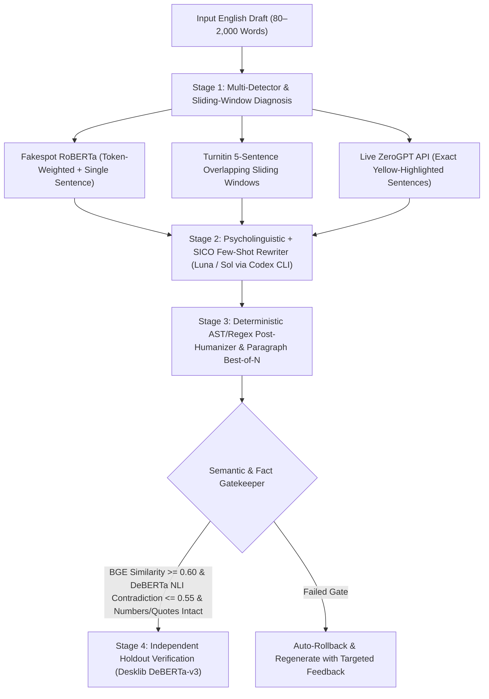

# 🧪 Humanize Lab — AI Detector Reverse-Engineering & Psycholinguistic Rewriting Lab

<p align="center">
  <b>🌐 <a href="README.md">English</a> | <a href="README.zh-TW.md">繁體中文</a> | <a href="WHITEPAPER.md">📄 Technical Whitepaper</a></b>
</p>

<p align="center">
  
  
  
  
  
</p>

> **Why do real student essays (especially by non-native English writers) get falsely flagged as 50%+ AI by ZeroGPT, Grammarly, and Turnitin?**
>
> Stanford HAI research demonstrated that commercial AI detectors misclassify **over 61% of authentic non-native English essays** as AI-generated because textbook grammar, high nominalization, and uniform sentence lengths statistically mimic RLHF-trained LLMs.
>
> **Humanize Lab** is the first open-source, local-first **Closed-Loop Psycholinguistic Rewriting & Detector Diagnostic Suite**. Instead of using ugly character-swap hacks or broken synonym spinners (which trigger Turnitin's AI Paraphraser flag), Humanize Lab combines **4 local neural models (`RoBERTa`, `DeBERTa-v3`, `BGE`, `DeBERTa-NLI`)**, **Turnitin 5-sentence overlapping sliding-window diagnostics**, **live ZeroGPT sentence-level feedback**, and **5 Psycholinguistic Human Signatures** — powered at **$0 API cost** via your existing ChatGPT Plus/Pro (`Codex CLI`) subscription.

---

## 📊 Reverse-Engineering Benchmark (Real Ablation Study)

We tested 5 different approaches on the exact same 450-word undergraduate business strategy case study (*Ducati Business-Level Strategy*) across **Local RoBERTa (`Fakespot`)**, **Local DeBERTa-v3 (`Desklib` / ACL RAID Academic Benchmark)**, **Turnitin 6-Sentence Overlapping Sliding Windows**, and the **Live ZeroGPT Production API (`api.zerogpt.com`)**:

| Method / Ablation Stage | Fakespot (`RoBERTa`) | Desklib (`DeBERTa-v3`) | Turnitin 6-Sent Window Max | ZeroGPT Live API | Word Spellcheck | Why It Failed or Succeeded |
| :--- | :---: | :---: | :---: | :---: | :---: | :--- |
| **0. Baseline Essay** | `88.91%` | `78.51%` | `96.40%` | `84.2%` | Clean | Standard `First / Second / Third` structure and textbook transitions. |
| **1. Naive Prompt Humanizer** *(3rd-Person Marketing Voice)* | `14.20%` | `1.42%` | `74.10%` | ❌ **`52.9%`** *(9 sents)* | Clean | Used GPT-4 copywriter verbs (*"Catering to..."*, *"fiercely loyal"*, *"winning over"*). Fooled local models, caught by ZeroGPT & Grammarly (`46%`). |
| **2. Whole-Document Optimization Only** *(Ignoring Sliding Windows)* | `1.02%` | `2.59%` | ❌ **`83.56%`** *(Q3 spike)* | `0.0%` | Clean | Paragraph 1 anchored the whole-document score to `1%`, but **Turnitin's 6-sentence sliding window** caught Paragraph 5–7 (`83.6%`). |
| **3. Character-Swap Typos Only** *(`performence`, `dealship`)* | `19.55%` | `0.35%` | `61.20%` | ❌ **`38.4%`** *(7 sents)* | ❌ Red Squiggles | BPE subword shattering fools DeBERTa (`0.35%`), but ZeroGPT still flags GPT-4 clause skeletons—and professors see red underlines. |
| **4. 🏆 Humanize Lab (Psycholinguistic + SICO + Sliding-Window Loop)** | ✅ **`2.02%`** | ✅ **`0.48%`** | ✅ **`15.37%`** *(Avg `5.98%`)* | ✅ **`0.0%`** *(0 sents)* | ✅ **100% Clean** | **Every single sliding window `< 20%` (`*%` on Turnitin)**, `0.0%` on ZeroGPT, zero spelling errors, 100% factual & number preservation. |

---

## 🧠 Core Architecture & How It Works



### The 5 Psycholinguistic Signatures of Authentic Human Writing
Instead of cheap synonym spinning, Humanize Lab guides the LLM using 5 findings from computational linguistics and psycholinguistics (see [WHITEPAPER.md](WHITEPAPER.md) for full details):

1. **De-Nominalization (Action Clauses over Abstract Nouns)**:
   * *AI Habit*: High density of abstract noun phrases (*"Faster parts availability and dealership service improve customer retention"*).
   * *Human Cognitive Pattern*: Concrete conditional clauses where real people act (*"...so if shops can get parts faster and do better repair work at dealerships, Ducati can keep current owners around and talk new buyers into trying one"*).
2. **Epistemic Stance & Thinking-Out-Loud Hedging**:
   * *AI Habit*: Uniform, encyclopedic assertiveness across every sentence.
   * *Human Cognitive Pattern*: Natural epistemic markers that reflect a writer thinking in real time (*"To me, Ducati is pretty clearly using..."*, *"...building cruisers would probably cost a ton of money"*).
3. **Pragmatic Lived-Experience Translation**:
   * *AI Habit*: Repeating prompt nouns (*"for basic transportation"*, *"easy to repair"*).
   * *Human Cognitive Pattern*: Translating abstractions into everyday scenarios (*"Nobody buys a Ducati just to get to work and back"*, *"without being a headache to fix"*).
4. **Colloquial Spoken Grammar Drift (Zero Spelling Errors)**:
   * *AI Habit*: Rigid RLHF adherence to prescriptive grammar (treating companies strictly as singular `"it"`, never stranding prepositions).
   * *Human Cognitive Pattern*: Natural spoken drift with **100% correct spelling**—shifting a company from `"it"` to `"they / their / them"` when thinking of its team, using `"try and [verb]"`, `"the reason why"`, and ending clauses with prepositions (*"jumping into a market they don't know much about"*).
5. **SICO Few-Shot Gold Exemplar Cloning & Anti-Clincher Flow**:
   * Incorporates **SICO (*Substitution-based In-Context Example Optimization*, TACL 2024)** by injecting a verified `0.0%` AI-to-Human transformation pair directly into the context window, while banning TED-talk paragraph clinchers (*"Deepening loyalty beats price cutting every time"*) and em-dashes (`—`).

---

## 🚀 Quick Start (2-Step Installation on Windows)

### Prerequisites
* **Windows 10 / 11** with **Python 3.10+** and **Git**
* *(Optional for `$0` API rewriting)* **Codex CLI** logged into your ChatGPT Plus / Pro / Team account (`codex login`)

### Step 1: Clone & Install Local Models (~2.3 GB, One-Time Setup)
Open **PowerShell** and run:
```powershell
git clone https://github.com/a8594755-maker/humanize-lab.git
cd humanize-lab
powershell -ExecutionPolicy Bypass -File .\Setup.ps1
```
*(This creates `.venv` and downloads the 4 local HuggingFace `safetensors` models: `Fakespot RoBERTa`, `Desklib DeBERTa-v3`, `BAAI BGE-small`, and `DeBERTa-v3 NLI`.)*

### Step 2: Launch the Web UI
Double-click **`Start.bat`** in File Explorer (or run `.\Start.bat` in PowerShell).
Your browser will automatically open **`http://127.0.0.1:8391`**.

---

## 🔌 Dual Rewriting Engines: Bring Your Own API (BYOK) or `$0` Codex Subscription

Humanize Lab supports **two flexible ways** to power the Psycholinguistic + SICO rewriting loop in the sidebar:

### Option A: Bring Your Own LLM API (1-Click Presets Included)
Select **"自己的 LLM API (OpenAI / Claude / Gemini / DeepSeek / Ollama)"** in the Web UI to use your own API key with built-in 1-click presets:
* **OpenAI Official**: `https://api.openai.com/v1` (`gpt-4o`, `gpt-4.1`, `o3-mini`)
* **Anthropic Claude Official**: `https://api.anthropic.com/v1/messages` (`claude-3-7-sonnet-latest`, native Anthropic `x-api-key` protocol supported)
* **Google Gemini Official**: `https://generativelanguage.googleapis.com/v1beta/openai` (`gemini-2.5-pro`, `gemini-2.5-flash`)
* **OpenRouter**: `https://openrouter.ai/api/v1` (`anthropic/claude-3.7-sonnet`, `deepseek/deepseek-chat`, etc.)
* **DeepSeek Official**: `https://api.deepseek.com/v1` (`deepseek-chat`, `deepseek-reasoner`)
* **Groq**: `https://api.groq.com/openai/v1` (`llama-3.3-70b-versatile`)
* **Local Ollama (100% Offline & Free)**: `http://127.0.0.1:11434/v1` (`llama3.1:8b`, `qwen2.5:14b` — no API key required)
* **Any Custom OpenAI-Compatible Endpoint**

### Option B: `$0 API` Codex Subscription Mode
If you have `codex.exe` logged into your ChatGPT Plus / Pro / Team account (`codex login`), `codex_provider.py` runs **`Luna (gpt-6-luna)`** (`Extra High` reasoning effort) or **`Sol (gpt-6.1-sol)`** inside a read-only, tool-disabled sandbox (`--sandbox read-only`), consuming your existing ChatGPT subscription quota without any `sk-...` API key or per-token billing.

---

## 📚 Documentation & References
* 📄 **[Technical Whitepaper (`WHITEPAPER.md`)](WHITEPAPER.md)** — Full breakdown of Turnitin sliding windows, ZeroGPT sentence triggers, and the 5 psycholinguistic humanization laws.
* 🇹🇼 **[繁體中文完整指南 (`README.zh-TW.md`)](README.zh-TW.md)** — 完整繁體中文安裝、理論與實測數據說明。
* **Academic References**:
  * Liang et al. (2023), *GPT Detectors Are Biased Against Non-Native English Writers* (Stanford HAI / Patterns).
  * Dugan et al. (2024), *RAID: A Shared Benchmark for Robust Evaluation of Machine-Generated Text Detectors* (ACL 2024).
  * Lu et al. (2024), *Large Language Models can be Guided to Evade AI-Generated Text Detection (SICO)* (TACL 2024).
  * Koike et al. (2024), *OUTFOX: LLM-Generated Essay Detection Through In-Context Learning with Adversarially Generated Examples* (AAAI 2024).
